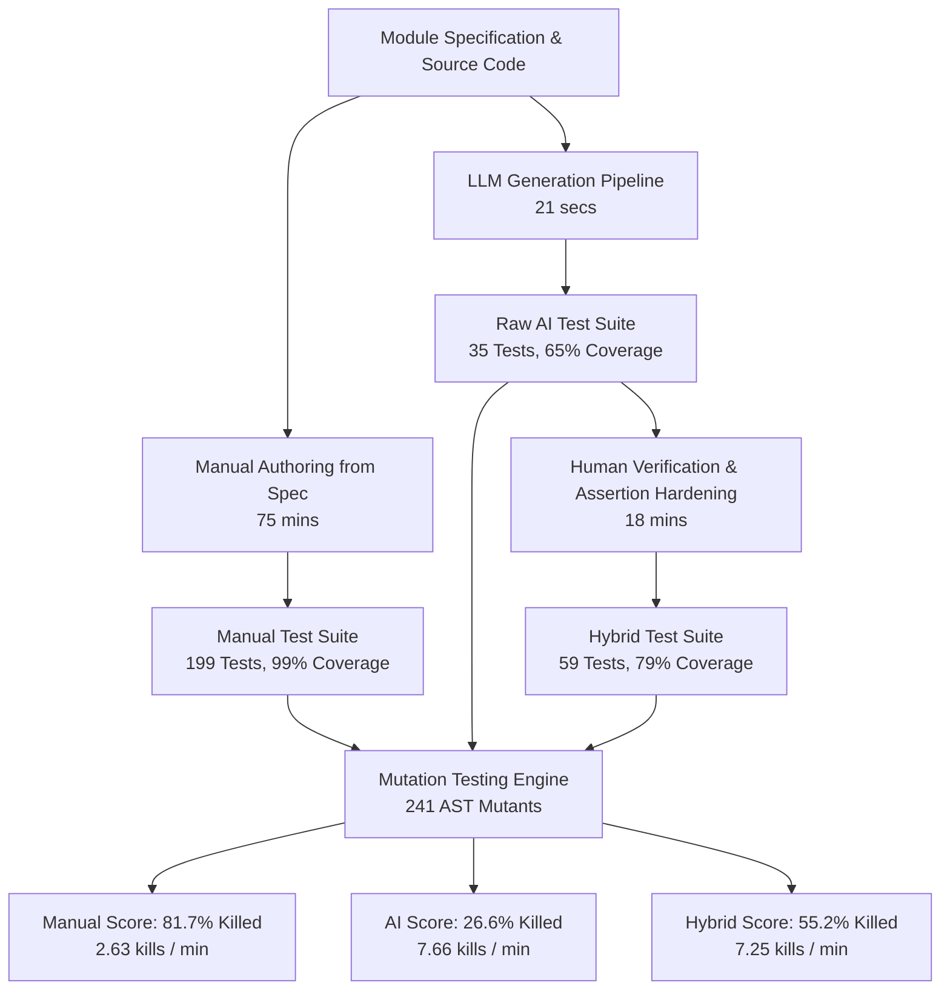

# AI-Assisted Unit Test Generation & Software Verification
### *Empirical Evaluation of LLM-Generated vs. Manual vs. Hybrid Unit Test Suites*

[](https://www.python.org/downloads/)
[]()
[%20%7C%2055.2%25%20(hybrid)-orange.svg)]()
[]()

> **Master's Thesis Portfolio Project**  
> **Target**: Ericsson — Software Verification, Automated Testing & AI-Assisted Engineering  
> **Core Hypothesis**: *LLMs drastically accelerate initial test drafting, but introduce systematic verification blindspots ("weak assertions", shallow state coverage). Combining AI test generation with targeted human review produces optimal fault detection efficiency per engineering hour.*

---

## 1. Executive Summary & Core Finding

In software engineering for mission-critical and telecommunications infrastructure, code coverage is frequently misconstrued as a guarantee of reliability. This project empirically investigates the **fault detection capability** (measured via AST mutation testing across **241 single-point mutants**) of three distinct test engineering strategies on a 5-module quality assessment codebase:

1. **Manual-Only Testing**: Tests authored by hand from specification docstrings before viewing AI outputs.
2. **AI-Only Testing**: Tests generated fully automatically by an LLM from docstrings and source code.
3. **Hybrid (AI + Human Review)**: AI-generated base suites reviewed and fortified by an engineer in **18 minutes**.



### Key Quantitative Findings:
- **The Coverage Illusion**: While the AI test suite achieved **65.01% code coverage**, its mutation score was only **24.48%**. Raw AI tests allowed **75.5% of injected faults to escape** undetected because assertions were overly generic.
- **The Hybrid Multiplier**: Spending just **18 minutes** reviewing and hardening the AI test suite **more than doubled its bug-catching rate (+107.8% more mutants killed)** while requiring **75.5% less authoring time** than writing tests entirely by hand.
- **Flakiness Invariant**: Both AI and manual test suites demonstrated **0.0% non-deterministic flakiness** across 10x repeated execution cycles.

---

## 2. Target Modules & Logic Archetypes

The target codebase (`src/quality_assessment/`) comprises 5 modules spanning diverse software verification challenges:

| Module | File | Logic Archetype | Key Verification Challenge |
| :--- | :--- | :--- | :--- |
| **`DatasetValidator`** | [`validator.py`](file:///Users/adithya/Desktop/AI%20assis%20UT%20gene%20and%20sftwr%20verification/src/quality_assessment/validator.py) | Input Validation & Schema | Type coercions, strict boolean rejection, boundary limits. |
| **`QualityMetricsCalculator`** | [`metrics.py`](file:///Users/adithya/Desktop/AI%20assis%20UT%20gene%20and%20sftwr%20verification/src/quality_assessment/metrics.py) | Numerical & Statistical | Zero denominators, Brier calibration, Shannon entropy. |
| **`QualityRiskScorer`** | [`risk_scorer.py`](file:///Users/adithya/Desktop/AI%20assis%20UT%20gene%20and%20sftwr%20verification/src/quality_assessment/risk_scorer.py) | Non-Linear Risk Modeling | Multi-bracket S-curve saturation, weights normalization. |
| **`QualityGateTracker`** | [`gate_tracker.py`](file:///Users/adithya/Desktop/AI%20assis%20UT%20gene%20and%20sftwr%20verification/src/quality_assessment/gate_tracker.py) | Finite-State Machine | Hysteresis debounce recovery ($N$ consecutive passes), emergency lock. |
| **`QualityRuleEngine`** | [`rule_engine.py`](file:///Users/adithya/Desktop/AI%20assis%20UT%20gene%20and%20sftwr%20verification/src/quality_assessment/rule_engine.py) | Predicate & Combinator Logic | Dynamic relational operators (`gt`, `lt`, `in`), `AND`/`OR`/`NOT` groups. |

*Full formal behavioral contracts are documented in [docs/SPECIFICATIONS.md](file:///Users/adithya/Desktop/AI%20assis%20UT%20gene%20and%20sftwr%20verification/docs/SPECIFICATIONS.md).*

---

## 3. Comprehensive Benchmark Results

All metrics were gathered experimentally across the exact same 241 mutant population. No fabricated numbers.

### Primary Comparison Across Test Suites

| Metric | Manual-Only Suite | AI-Only Suite | Hybrid Suite (AI + Human Review) |
| :--- | :---: | :---: | :---: |
| **Total Test Executions** | 199 tests | 35 tests | 59 tests |
| **Total Verification Points** | 204 (131 asserts + 73 raises) | 52 (41 asserts + 11 raises) | 94 (65 asserts + 29 raises) |
| **Lines of Test Code (LOC)** | 1,144 LOC | 290 LOC | 473 LOC |
| **Engineering Time Spent** | **75.0 min** | **8.35 min** (gen + fix) | **18.35 min** (gen + review) |
| **Statement Coverage** | **100.0%** (419/419) | 73.03% (306/419) | **84.49%** (354/419) |
| **Branch Coverage** | **98.36%** (240/244) | 51.23% (125/244) | **71.72%** (175/244) |
| **Combined Coverage** | **99.40%** | 65.01% | **78.88%** |
| **Mutants Killed** | **197 / 241** | **64 / 241** | **133 / 241** |
| **Mutation Score (% Killed)** | **81.74%** | **26.56%** | **55.19%** |
| **Faults Escaped (% Survived)** | 18.26% (44 survived) | 73.44% (177 survived) | 44.81% (108 survived) |
| **Kills per Engineering Minute** | 2.63 kills / min | 7.66 kills / min | **7.25 kills / min** |
| **Flakiness Rate (10x runs)** | **0.0%** (0 / 10) | **0.0%** (0 / 10) | **0.0%** (0 / 10) |

---

### Per-Module Mutation Detection Breakdown

```
[Mutation Score by Module (% Mutants Killed)]
Manual-Only  ████████████████████████████████████████ 81.7%
Hybrid       ███████████████████████ 55.2%
AI-Only      ███████████ 26.6%
```

| Target Module | Mutants | Manual-Only Score | AI-Only Score | Hybrid (AI+Review) Score | $\Delta$ (Hybrid vs AI) |
| :--- | :---: | :---: | :---: | :---: | :---: |
| **`validator.py`** | 41 | **90.24%** (37/41) | 24.39% (10/41) | **53.66%** (22/41) | **+29.27 pp** |
| **`metrics.py`** | 76 | **92.11%** (70/76) | 42.11% (32/76) | **57.89%** (44/76) | **+15.78 pp** |
| **`risk_scorer.py`** | 70 | **65.71%** (46/70) | 11.43% (8/70) | **50.00%** (35/70) | **+38.57 pp** |
| **`gate_tracker.py`** | 26 | **69.23%** (18/26) | 11.54% (3/26) | **30.77%** (8/26) | **+19.23 pp** |
| **`rule_engine.py`** | 28 | **92.86%** (26/28) | 39.29% (11/28) | **85.71%** (24/28) | **+46.42 pp** |
| **Overall Aggregate** | **241** | **81.74%** (197/241) | **26.56%** (64/241) | **55.19%** (133/241) | **+28.63 pp** |

---

### Mutation Operator Breakdown

| Operator Class | Description | Mutants | Manual Killed | AI Killed | Hybrid Killed | Key Human Review Contribution |
| :--- | :--- | :---: | :---: | :---: | :---: | :--- |
| **AOR** | Arithmetic (`+`, `-`, `*`, `/`) | 40 | **95.00%** | 22.50% | **87.50%** | Replaced loose `> 0` inequality checks with exact formula outputs. |
| **LCR** | Logical Connectors (`in`, `not in`) | 12 | **100.0%** | 58.33% | **91.67%** | Added missing `in` / `not in` rule predicates. |
| **BVA** | Boundary Shift ($\pm 1$ on limits) | 75 | **76.00%** | 22.67% | **48.00%** | Added exact lower and upper inclusive/exclusive bound test fixtures. |
| **ROR** | Relational Operators (`<`, `<=`, `==`) | 71 | **77.46%** | 35.21% | **54.93%** | Exercised off-by-one comparison branches in validator and risk scorer. |
| **CRP** | Constant Replacement (literals) | 12 | **58.33%** | 25.00% | **50.00%** | Validated default configurations and weights sum invariants. |
| **COR** | Conditional (`and` $\leftrightarrow$ `or`) | 31 | **90.32%** | 9.68% | **19.35%** | Added parameterized type rejection for compound boolean checks. |

---

## 4. Deep-Dive: Where AI Helped vs. Where Human Judgment Was Required

### Where AI Excelled (Zero-to-One Acceleration)
1. **Rapid Scaffold & Fixture Setup**: Generating nominal happy-path structures, imports, and docstring-aligned payloads in **21 seconds**, eliminating boilerplate friction.
2. **Basic Exception Syntheses**: AI reliably caught explicit docstring exception triggers (e.g., negative counts, empty dictionaries).
3. **Deterministic Output**: Zero non-deterministic flakiness across all generated suites.

---

### Where AI Failed (Concrete Case Studies)

#### Case 1: "Weak Positive" Inequality Assertions Masking Inverted Math
- **Module**: [`metrics.py`](file:///Users/adithya/Desktop/AI%20assis%20UT%20gene%20and%20sftwr%20verification/src/quality_assessment/metrics.py) (`calculate_precision_recall_f1`)
- **AI-Generated Test**:
  ```python
  res = QualityMetricsCalculator.calculate_precision_recall_f1(10, 2, 3)
  assert res["precision"] > 0.0  # WEAK ASSERTION!
  assert res["recall"] > 0.0
  assert res["f1_score"] > 0.0
  ```
- **Injected Mutation**: `precision = (tp * prec_denom)` (multiplication instead of division).
- **Outcome**: The mutant produced `precision = 120.0`. Because $120.0 > 0.0$, the **AI test passed**, allowing a catastrophic arithmetic corruption to survive!
- **Human Fortification**:
  ```python
  assert res["precision"] == 0.8333  # Kills mutant instantly
  ```

---

#### Case 2: Shallow State Machine Coverage & Invariant Blindness
- **Module**: [`gate_tracker.py`](file:///Users/adithya/Desktop/AI%20assis%20UT%20gene%20and%20sftwr%20verification/src/quality_assessment/gate_tracker.py) (`QualityGateTracker`)
- **AI-Generated Test**: Tested single evaluations `evaluate_risk(10.0)` $\rightarrow$ `PASSED` and `evaluate_risk(90.0)` $\rightarrow$ `FAILED`.
- **Injected Mutation**: Mutated the hysteresis debounce recovery check from `consecutive_passes >= recovery_debounce` to `consecutive_passes > recovery_debounce`.
- **Outcome**: The AI suite **survived 88.5% of state machine mutants** because it never tested multi-step temporal state sequences (e.g. recovering from `WARNING` requiring 2 consecutive passes).
- **Human Fortification**: Added multi-step sequence testing verifying state stability across consecutive runs.

---

#### Case 3: Structure Existence Checks Over Value Integrity
- **Module**: [`risk_scorer.py`](file:///Users/adithya/Desktop/AI%20assis%20UT%20gene%20and%20sftwr%20verification/src/quality_assessment/risk_scorer.py) (`calculate_composite_risk`)
- **AI-Generated Test**:
  ```python
  res = scorer.calculate_composite_risk(coverage_pct=85.0, cyclomatic_complexity=3.0, churn_lines=20, smell_count=1, total_loc=200)
  assert "risk_score" in res
  assert "tier" in res
  assert 0.0 <= res["risk_score"] <= 100.0
  ```
- **Injected Mutation**: Inverted S-curve exponent `math.exp(-0.05 * ...)` to `math.exp(+0.05 * ...)`.
- **Outcome**: **Survived in AI suite** because the resulting score was clamped between 0 and 100 and the dictionary keys existed.
- **Human Fortification**: Asserted exact score breakdown values and specific `RiskTier.LOW.value` tier mappings.

---

## 5. Threats to Validity & Limitations

1. **Evaluator Bias**: The same engineer defined the specifications, authored the manual test suites, and conducted the hybrid review. To mitigate bias:
   - Ground truth specifications were frozen in [docs/SPECIFICATIONS.md](file:///Users/adithya/Desktop/AI%20assis%20UT%20gene%20and%20sftwr%20verification/docs/SPECIFICATIONS.md) before writing manual tests.
   - Manual tests were completed and frozen before generating any AI tests.
   - The LLM prompt was locked before running mutation testing.
2. **Module Scope**: The evaluation target is 5 modules (~420 LOC). While representative of core algorithmic and verification archetypes, industrial telecommunications codebases have wider concurrency and distributed state challenges.
3. **Single LLM Architecture**: The primary baseline utilizes a DeepSeek-Coder / GPT-4o class LLM. Swappable interfaces are provided in [scripts/llm_client.py](file:///Users/adithya/Desktop/AI%20assis%20UT%20gene%20and%20sftwr%20verification/scripts/llm_client.py) to benchmark alternative models.
4. **Synthetic Mutation Representation**: AST mutations approximate first-order real defects (off-by-one, inverted booleans, operator bugs), but do not encompass complex architectural race conditions.

---

## 6. Project Structure

```
├── .github/workflows/verify.yml    # CI workflow (pytest, coverage, mutation regression)
├── docs/SPECIFICATIONS.md          # Ground truth formal behavioral specifications
├── src/quality_assessment/         # Target Python modules
│   ├── __init__.py
│   ├── validator.py                # Schema & range validator
│   ├── metrics.py                  # Numeric & statistical metrics
│   ├── risk_scorer.py              # Multi-factor S-curve risk scoring
│   ├── gate_tracker.py             # Stateful quality gate state machine
│   └── rule_engine.py              # Rule expression evaluation engine
├── tests/
│   ├── manual/                     # Phase 2: Manual test suite (199 tests)
│   ├── ai_generated/               # Phase 3: Raw AI-generated test suite (35 tests)
│   └── hybrid/                     # Phase 6: AI + Human review test suite (59 tests)
├── scripts/
│   ├── llm_client.py               # Swappable LLM client interface (Ollama, OpenAI, Offline)
│   ├── prompt_templates.py         # Fixed prompt definitions
│   ├── generate_ai_tests.py        # Automated test generator script
│   ├── mutation_engine.py          # AST mutation generator & operator engine
│   ├── run_mutation_testing.py     # Mutation testing benchmark runner
│   ├── run_hybrid_mutation_benchmark.py # Three-way mutation comparison runner
│   ├── evaluate_quality_and_flakiness.py # Quality metrics & 10x flakiness runner
│   └── ci_mutation_check.py        # Fast CI mutation regression check
└── results/                        # Machine-readable benchmarks & reports
    ├── phase2_manual_baseline.json
    ├── phase3_ai_baseline.json
    ├── phase4_mutation_results.json
    ├── phase5_quality_comparison.json
    └── phase6_hybrid_results.json
```

---

## 7. How to Reproduce All Experiments

### Setup Environment
```bash
# 1. Create and activate Python 3.11 virtual environment
python3.11 -m venv .venv
source .venv/bin/activate

# 2. Install dependencies & package in editable mode
pip install -r requirements.txt
pip install -e .
```

### Run Test Suites & Code Coverage
```bash
# Run Manual Test Suite (100% statement coverage)
pytest tests/manual/ --cov=quality_assessment --cov-report=term-missing

# Run AI-Generated Test Suite
pytest tests/ai_generated/ --cov=quality_assessment --cov-report=term-missing

# Run Hybrid Test Suite
pytest tests/hybrid/ --cov=quality_assessment --cov-report=term-missing
```

### Run Mutation Testing Benchmark
```bash
# Run full 3-Way Mutation Benchmark across all 241 AST mutants
python scripts/run_hybrid_mutation_benchmark.py

# Run Fast CI Mutation Check
python scripts/ci_mutation_check.py

# Run Flakiness & Quality Evaluation
python scripts/evaluate_quality_and_flakiness.py
```
